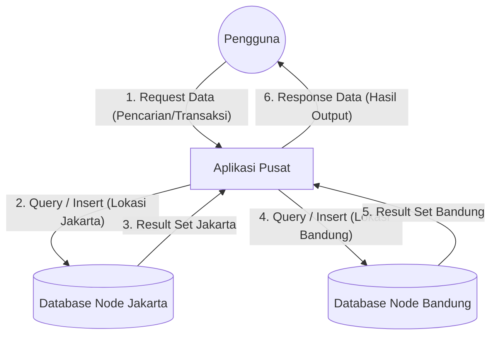

# 📚 Jawaban Tugas Praktikum dan Pertanyaan Analisis (Bagian 8)

Berikut adalah jawaban lengkap untuk pertanyaan analisis di Bagian 8 Modul Praktikum Anda. Anda bisa menggunakan ini sebagai referensi untuk laporan tugas Anda.

---

### 1. Gambarkan arsitektur sederhana yang memuat pengguna, aplikasi, dan dua node basis data. Beri label aliran permintaan dan respons.

Arsitektur di bawah ini menggambarkan pola *Client-Server* terdistribusi, di mana Aplikasi Pusat (sebagai router) akan mengarahkan koneksi ke Node (Database) yang tepat sesuai dengan lokasi data pelanggan.

---

### 2. Mengapa transaksi peminjaman dapat lebih sesuai menggunakan fragmentasi horizontal per cabang?

Transaksi peminjaman bersifat sangat **lokal**. Pelanggan di Jakarta hampir selalu meminjam buku di cabang Jakarta. Oleh karena itu, memecah (mem-fragmentasi) data peminjaman berdasarkan lokasi cabang memberikan beberapa keuntungan besar:
- **Performa Lebih Cepat:** Cabang Jakarta hanya memproses tabel yang berisi warga Jakarta saja (tabel lebih kecil & ringan).
- **Ketersediaan (Availability) Tinggi:** Jika server Bandung mati atau koneksi putus, server Jakarta tetap bisa melayani peminjaman pelanggan lokal tanpa masalah.
- **Hemat Bandwidth Jaringan:** Tidak perlu menarik data transaksi terus-menerus ke server pusat atau server kota lain.

---

### 3. Mengapa katalog buku mungkin cocok direplikasi ke beberapa cabang? Sebutkan risiko jika perubahan katalog tidak tersinkron.

- **Alasan Replikasi (Penggandaan):** Katalog buku (daftar judul buku yang tersedia) adalah referensi yang **sangat sering dibaca** oleh semua cabang (untuk pencarian), tetapi **jarang diubah**. Dengan mereplikasi katalog ke semua cabang, setiap cabang bisa melakukan pencarian buku secara instan tanpa perlu menghubungi server kota lain.
- **Risiko jika tidak tersinkron (Inkonsistensi Data):** Jika pusat menambahkan buku baru atau menghapus buku yang rusak, tetapi server cabang Bandung gagal melakukan sinkronisasi, maka pelanggan di Bandung tidak akan tahu ada buku baru, atau lebih parahnya, mereka bisa mencoba meminjam buku yang secara fisik sudah tidak ada.

---

### 4. Apa perbedaan simulasi dua schema dalam satu instance PostgreSQL dengan dua server basis data yang benar-benar terdistribusi?

| Kriteria | Simulasi (1 Instance, 2 Schema) | Server Terdistribusi Asli (2 Instance) |
| :--- | :--- | :--- |
| **Bentuk Fisik** | Menggunakan 1 mesin komputer (CPU, RAM, HDD yang sama). | Menggunakan 2 komputer terpisah. |
| **Jaringan & Performa** | Tidak ada *delay* jaringan. Query gabungan (`UNION ALL`) sangat cepat karena terjadi di RAM yang sama. | Rentan terhadap latensi/putus jaringan. Query gabungan memakan *bandwidth* antar-komputer. |
| **Fault Tolerance (Toleransi Kesalahan)** | **Sangat Buruk.** Jika PostgreSQL mati, kedua cabang ikut mati total (*Single point of failure*). | **Sangat Baik.** Jika server Jakarta rusak, server Bandung tetap menyala dan bisa beroperasi sendiri. |

---

### 5. Bandingkan fragmentasi dan replikasi dari sisi ruang penyimpanan, kecepatan baca, pembaruan data, dan kompleksitas.

| Kriteria | Fragmentasi Horizontal (Data Dipecah) | Replikasi (Data Digandakan) |
| :--- | :--- | :--- |
| **Ruang Penyimpanan (Storage)** | **Hemat.** Ukuran total tabel sama dengan aslinya, hanya tersebar. | **Boros.** Ukuran data berlipat ganda sesuai jumlah server. |
| **Kecepatan Baca (Read)** | Sangat cepat untuk data lokal. Sangat lambat jika harus membaca laporan seluruh cabang (gabungan). | **Sangat Cepat.** Karena semua data tersedia utuh di mesin lokal. |
| **Pembaruan Data (Update)** | **Cepat & Aman.** Pembaruan cukup dilakukan di server lokal tempat data berada. | **Lambat & Berisiko.** Pembaruan harus disinkronisasikan ke semua server agar tidak terjadi bentrok. |
| **Kompleksitas** | Sulit di tahap merancang *query* (harus tahu data mana di server mana). | Sulit di tahap pemeliharaan (menjaga semua salinan data tetap sama/sinkron). |

---

### 6. Jika koneksi antar-cabang terputus, operasi apa yang tetap dapat dilakukan secara lokal? Data apa yang berisiko menjadi tidak mutakhir?

- **Operasi yang tetap bisa dilakukan:** 
  - Penambahan pelanggan baru dari cabang itu sendiri.
  - Proses transaksi peminjaman/pengembalian buku oleh pelanggan di cabang tersebut.
  - Pencarian katalog buku (berdasarkan salinan replikasi terakhir).
- **Data yang berisiko tidak mutakhir (Out-of-Sync):**
  - **Katalog Buku:** Data buku baru atau buku hilang tidak akan ter-update.
  - **Laporan Keseluruhan:** Tidak bisa membuat laporan total pendapatan/transaksi karena server pusat kehilangan kontak dengan cabang tersebut.

---

### 7. Usulkan strategi untuk menghindari ID pelanggan ganda dan menjelaskan cara menggabungkan laporan dari kedua cabang.

**A. Strategi Menghindari ID Ganda (Primary Key Collision):**
1. **Penggunaan Kode Cabang (Composite Key):** Menambahkan inisial kota pada ID pelanggan, contohnya `JKT-001` dan `BDG-001`.
2. **Auto-Increment Beda Range:** Membagi jatah nomor urut. Jakarta diberi jatah ID mulai 1 hingga 1.000.000. Bandung diberi jatah ID 1.000.001 hingga 2.000.000.
3. **Menggunakan UUID:** Menggunakan *Universally Unique Identifier* (kode acak panjang) sebagai ID. Kemungkinan bentrok UUID di dua server yang berbeda hampir mustahil.

**B. Cara Menggabungkan Laporan (Reporting):**
- **Sistem Real-time:** Menggunakan *Distributed Query* atau fitur *Foreign Data Wrapper (FDW)* pada PostgreSQL, sehingga server pusat bisa menjalankan perintah `SELECT ... UNION ALL ...` ke semua cabang setiap kali tombol "Generate Report" ditekan.
- **Sistem Batch (Data Warehouse):** Menggunakan metode *ETL (Extract, Transform, Load)* yang berjalan setiap malam jam 00:00. Sistem akan menyedot data terbaru dari semua cabang dan menumpuknya di satu Server Pusat (khusus laporan/OLAP). Ini menghindari server transaksi menjadi lemot saat siang hari.
