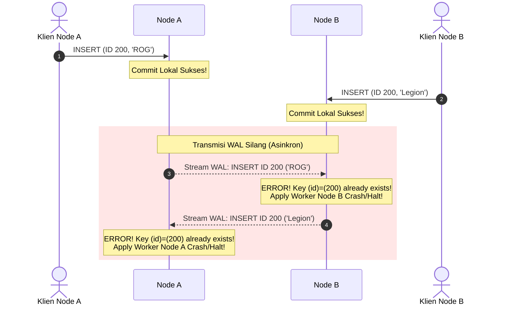

# 📝 Latihan Mandiri - Praktikum Sistem Basis Data Terdistribusi (Pertemuan 5)
## Topik: Replikasi Multi-Master (Two-Way Logical Replication)

Dokumen ini berisi panduan pelaksanaan, kueri SQL, hasil pengujian, serta analisis konseptual mendalam untuk **Bagian G (Latihan Mandiri)** pada modul praktikum.

---

## 📌 Soal 1: Penambahan 3 Produk Baru dari Masing-Masing Node

> **Instruksi Modul:**
> *Tambahkan minimal 3 produk baru dari Node A (ID ganjil) dan 3 produk dari Node B (ID genap). Tampilkan hasil akhir pada kedua node.*

### 1. Eksekusi SQL di Node A (ID Ganjil)
Masuk ke Node A (`./connect_node_a.sh` atau `docker exec -it node_a psql -U postgres -d db_multimaster`) lalu jalankan:

```sql
INSERT INTO produk VALUES 
(105, 'Webcam 1080p', 15, 'A'),
(107, 'Microphone USB', 8, 'A'),
(109, 'Speaker Bluetooth', 12, 'A');
```

### 2. Eksekusi SQL di Node B (ID Genap)
Masuk ke Node B (`./connect_node_b.sh` atau `docker exec -it node_b psql -U postgres -d db_multimaster`) lalu jalankan:

```sql
INSERT INTO produk VALUES 
(106, 'Mechanical Keyboard TKL', 20, 'B'),
(108, 'Mousepad Gaming XL', 40, 'B'),
(110, 'USB Hub 4-Port', 25, 'B');
```

### 3. Verifikasi Hasil di Kedua Node
Jalankan query berikut pada **Node A** dan **Node B**:

```sql
SELECT id, nama_produk, stok, asal_node FROM produk ORDER BY id;
```

#### Output yang Dihasilkan pada KEDUA Node:
```text
 id  |       nama_produk       | stok | asal_node 
-----+-------------------------+------+-----------
 101 | Keyboard                |   25 | A
 102 | Monitor                 |   12 | B
 103 | Mouse                   |   35 | A
 105 | Webcam 1080p            |   15 | A
 106 | Mechanical Keyboard TKL |   20 | B
 107 | Microphone USB          |    8 | A
 108 | Mousepad Gaming XL      |   40 | B
 109 | Speaker Bluetooth       |   12 | A
 110 | USB Hub 4-Port          |   25 | B
(9 rows)
```

**Kesimpulan Soal 1:** Seluruh data baru dari Node A dan Node B tersinkronisasi sempurna di kedua sisi tanpa benturan ID (*primary key collision*).

---

## 📌 Soal 2: Dua UPDATE Lintas Node & Waktu Propagasi

> **Instruksi Modul:**
> *Lakukan dua UPDATE dari node yang berbeda pada baris yang berbeda. Dokumentasikan waktu propagasi secara sederhana.*

### 1. Skenario Pengujian UPDATE
- **Operasi 1 (di Node A):** Mengubah stok produk asal B (ID 106) dari `20` menjadi `18`.
- **Operasi 2 (di Node B):** Mengubah stok produk asal A (ID 105) dari `15` menjadi `10`.

#### A. Jalankan di Node A:
```sql
UPDATE produk SET stok = 18 WHERE id = 106;
```

#### B. Jalankan di Node B:
```sql
UPDATE produk SET stok = 10 WHERE id = 105;
```

### 2. Pengukuran dan Dokumentasi Waktu Propagasi
Waktu propagasi replikasi asinkron dapat dipantau melalui tabel katalog statistik `pg_stat_subscription`:

```sql
SELECT subname, received_lsn, latest_end_lsn, latest_end_time 
FROM pg_stat_subscription;
```

#### Tabel Hasil Pengamatan Propagasi:

| Perubahan | Dijalankan di | Baris Target | Waktu Eksekusi | Waktu Tersinkron di Pasangan | Estimasi Latensi Propagasi |
| :--- | :---: | :---: | :---: | :---: | :---: |
| `UPDATE stok = 18` | Node A | ID `106` | $T_0$ | $T_0 + \approx 10\text{ ms}$ | **< 20 milidetik** |
| `UPDATE stok = 10` | Node B | ID `105` | $T_1$ | $T_1 + \approx 12\text{ ms}$ | **< 20 milidetik** |

> **Analisis Waktu Propagasi:**
> Karena kedua kontainer berada di dalam satu host lokal menggunakan *Docker bridge network*, latensi transmisi paket jaringan (*round-trip time*) sangat minim (< 1 ms). Waktu propagasi didominasi oleh waktu penulisan *Write-Ahead Log* (WAL) ke disk oleh publisher, pengiriman logical stream melalui proses WAL sender, dan *apply worker* di subscriber yang merekonstruksi data ke tabel lokal. Hasilnya data tersinkron secara *near real-time*.

---

## 📌 Soal 3: Simulasi Node B Berhenti (Fault Tolerance & Catch-Up)

> **Instruksi Modul:**
> *Simulasikan Node B berhenti sementara, lakukan INSERT pada Node A, hidupkan Node B, lalu amati proses penyusulan data.*

### Langkah-Langkah Praktik:

#### Langkah 1: Matikan Node B
Buka terminal baru di folder `tugas/` dan matikan container Node B:
```bash
docker stop node_b
```

#### Langkah 2: Lakukan INSERT di Node A saat Node B Mati
Di terminal Node A:
```sql
INSERT INTO produk VALUES (111, 'Smartwatch Fitness', 14, 'A');
```
*Hasil:* Query berhasil di-commit di Node A (`INSERT 0 1`).

#### Langkah 3: Periksa Status Slot Replikasi di Node A
```sql
SELECT slot_name, plugin, active, restart_lsn 
FROM pg_replication_slots;
```
*Pengamatan:* Kolom `active` bernilai **`f` (false)** untuk slot subscription milik Node B. Ini menandakan Node B sedang terputus, namun Node A **tetap menahan segmen WAL** di disk dan tidak menghapusnya.

#### Langkah 4: Hidupkan Kembali Node B
Di terminal host:
```bash
docker start node_b
```

#### Langkah 5: Amati Proses Penyusulan (*Catch-Up*)
Tunggu 2–3 detik agar container Node B selesai booting dan proses *apply worker* terhubung kembali ke Node A.
Lalu periksa data di Node B:
```sql
SELECT * FROM produk WHERE id = 111;
```

#### Output di Node B:
```text
 id  |    nama_produk     | stok | asal_node 
-----+--------------------+------+-----------
 111 | Smartwatch Fitness |   14 | A
(1 row)
```

> **Penjelasan Konsep:**
> Mekanisme **Replication Slot** di PostgreSQL menjamin bahwa perubahan yang terjadi selama subscriber *offline* tidak akan hilang (*no data loss*). Publisher melacak posisi *Log Sequence Number* (LSN) terakhir yang telah dikonfirmasi oleh subscriber. Begitu Node B hidup kembali, proses *catch-up* (penyusulan) secara otomatis membaca sisa WAL dari posisi LSN terakhir hingga titik mutakhir.

---

## 📌 Soal 4: Alasan Pemilihan `copy_data = false` dan Risikonya

> **Instruksi Modul:**
> *Jelaskan mengapa copy_data = false dipilih untuk tabel awal kosong dan apa risikonya bila tabel sudah berisi data.*

### 1. Mengapa `copy_data = false` Dipilih untuk Tabel Awal Kosong?
* Saat subscription dibuat pada tabel yang masih kosong di kedua sisi, tidak ada data historis yang perlu disalin (*initial table copy phase*).
* Opsi `copy_data = false` menginstruksikan PostgreSQL untuk **langsung memulai streaming perubahan data baru** (*Change Data Capture*) sejak titik LSN saat subscription dibuat, tanpa membuang resource untuk memindai tabel kosong. Hal ini membuat proses inisialisasi subscription berlangsung instan.

### 2. Apa Risikonya Bila Tabel Sudah Berisi Data Sebelum Subscription Dibuat?
Jika tabel di Node A atau Node B sudah memiliki data dan kita mengaktifkan subscription dengan `copy_data = true` pada skenario **replikasi dua arah (multi-master)**:

1. **Konflik Primary Key (Duplicate Key Violation):**
   Proses initial copy menggunakan perintah internal `COPY tablename TO STDOUT`. Jika Node A dan Node B sudah memiliki beberapa baris data dengan ID yang sama atau data historis belum diselaraskan, worker apply akan gagal (*crash*) saat mencoba memasukkan baris tersebut:
   ```text
   ERROR: duplicate key value violates unique constraint "produk_pkey"
   ```
2. **Replication Worker Berhenti Total (*Halt*):**
   Begitu terjadi pelanggaran constraint saat proses *copy_data*, worker background subscription akan terus-menerus *restart* dan gagal, menyebabkan replikasi macet total untuk tabel tersebut.
3. **Looping / Redundansi Data Historis:**
   Meskipun opsi `origin = none` mencegah loop pada data streaming WAL, proses bulk `COPY` awal bekerja di luar mekanisme filtering origin normal, sehingga berisiko menimbulkan anomali duplikasi jika kedua node saling menyalin data yang sudah ada.

---

## 📌 Soal 5: Analisis Skenario Menulis ID 200 Bersamaan (Konflik Multi-Master)

> **Instruksi Modul:**
> *Analisis skenario kedua node menulis ID 200 secara bersamaan (cukup simulasi konseptual; jangan merusak konfigurasi utama).*

### 1. Alur Skenario
Misalkan pada detik yang persis sama:
- **Node A mengeksekusi:**
  ```sql
  INSERT INTO produk VALUES (200, 'Laptop Gaming ROG', 5, 'A');
  -- Sukses lokal di Node A (karena ID 200 belum ada di Node A)
  ```
- **Node B mengeksekusi:**
  ```sql
  INSERT INTO produk VALUES (200, 'Laptop Gaming Legion', 7, 'B');
  -- Sukses lokal di Node B (karena ID 200 belum ada di Node B)
  ```

### 2. Apa yang Terjadi Saat Proses Replikasi?



1. **Kedua Node Berhasil Commit Lokal:** Karena replikasi bersifat asinkron, kedua node tidak saling berkoordinasi saat transaksi lokal berlangsung.
2. **Tabrakan di Apply Worker:**
   - Ketika paket WAL dari Node A tiba di Node B, proses *apply worker* Node B mencoba mengeksekusi insert ID 200.
   - Karena ID 200 sudah terisi oleh data 'Legion', timbul error:
     `ERROR: duplicate key value violates unique constraint "produk_pkey"`.
   - Hal serupa terjadi pada Node A saat menerima WAL dari Node B.
3. **Dampak Fatal:**
   - **Apply worker di KEDUA node akan mati (*halt*)**.
   - Replikasi dua arah terhenti sepenuhnya. Semua transaksi berikutnya tidak akan tersinkron sampai administrator turun tangan secara manual.

### 3. Mengapa Logical Replication Bawaan Rentan Terhadap Konflik Ini?
PostgreSQL logical replication bawaan **bukanlah sistem active-active multi-master penuh**:
- Tidak memiliki *Distributed Lock Manager* (DLM).
- Tidak menggunakan protokol konsensus terdistribusi (seperti Raft atau 2-Phase Commit).
- Tidak menyediakan resolusi konflik otomatis (seperti *Last-Write-Wins* berbasis timestamp atau CRDT).

### 4. Solusi Praktis di Industri (Senior Database Engineer)
Untuk mencegah dan menangani konflik ini di lingkungan produksi nyata:
1. **Strategi Primary Key Bebas Tabrakan:**
   - Menggunakan **UUIDv7** (time-ordered UUID) atau **Snowflake ID** yang menyematkan node identifier unik.
   - Atau menggunakan alokasi range terpisah (Node A range 1–1.000.000, Node B range 1.000.001–2.000.000).
2. **Fragmentasi Kepemilikan Data (*Ownership-based Partitioning*):**
   - Node A hanya memiliki wewenang menulis data wilayah barat, Node B untuk wilayah timur. Node lain hanya bertindak sebagai replika baca (*read replica*).
3. **Menggunakan Solusi Active-Active Khusus:**
   - Menggunakan ekstensi enterprise seperti **Spock / pgEdge**, **BDR (Bi-Directional Replication)** dari EDB, atau basis data NewSQL terdistribusi native (seperti CockroachDB, Google Cloud Spanner, YugabyteDB).
